# Awesome-Healthcare-Conversational-AI

# 🎬 Awesome Healthcare Conversational AI

  

  

  

  

  

  

  

---

## 🚀 Top Healthcare Conversational AI Ecosystem

**Curated List of SaaS Products & Open-Source GitHub Projects for Healthcare AI Engineers, Clinical Informaticists & Digital Health Architects**  

*Focused on Symptom Checkers, Medical Triage Chatbots, Mental Health Support Bots, Clinical Decision Support & Patient Engagement Platforms*  

📅 **Last updated:** October 2026

---

### 💡 Overview & SEO Keywords

This repository tracks notable **SaaS platforms** and **open-source projects** for **Healthcare Conversational AI**. In modern digital health, conversational AI systems power symptom assessment, triage, chronic care management, mental health support, and patient navigation—bridging the gap between patients and clinical resources through natural language interfaces.

Key architectural concepts and search keywords covered include:

- **Symptom Checkers & Triage**: AI-powered platforms (Ada, Infermedica, Buoy Health) that gather patient-reported symptoms and provide urgency recommendations or care pathways.

- **Medical Triage Chatbots**: Conversational systems (K Health, GYANT, Sensely) that guide patients through clinical workflows, intake, and care navigation.

- **Mental Health Support Bots**: Evidence-based conversational agents (Woebot, Wysa) delivering CBT-style interventions and emotional support.

- **Clinical Decision Support**: APIs and frameworks (Infermedica API, Lina) enabling developers to embed medical reasoning into applications.

- **Regional & Localized Assistants**: Framework-level projects (Lina Egyptian Medical Chatbot) addressing underserved markets with local-language and region-specific medical knowledge.

---

## 📋 Table of Contents

- [📊 Sector Overview & Market Dynamics](#-sector-overview--market-dynamics)

- [☁️ SaaS/Hosted Platforms](#️-saashosted-platforms)

- [🔓 Open-Source GitHub Projects](#-open-source-github-projects)

- [🏗️ Architectural Guidelines & Pipelines](#️-architectural-guidelines--pipelines)

- [🤝 How to Contribute](#-how-to-contribute)

- [💖 Support & Community](#-support--community)

- [⚠️ Disclaimer](#️-disclaimer)

- [⭐ Star History](#-star-history)

---

## 📊 Sector Overview & Market Dynamics

> 📈 **Estimated Market Size & Sector Structure:** The global healthcare conversational AI market is estimated at **$1.8 Billion** in 2026, projected to exceed **$8.5 Billion by 2032** (CAGR ~28%). The sector exhibits a **moderately fragmented** structure: clinical-grade platforms (K Health, Ada Health, Fabric/GYANT, Infermedica) vie for hospital and payer digital front door integrations, while specialized mental health conversational agents (Wysa, Woebot) and niche developer APIs serve distinct segments without a single winner-take-all monopoly.

---

## ☁️ SaaS/Hosted Platforms

| Platform / Service | Company Size (Valuation / Revenue) ↓ | Pricing (Starting Tier) | Free Tier / Free Trial Limit | Key Focus & Capabilities |
| :--- | :--- | :--- | :--- | :--- |
| **[Babylon Health](https://www.babylonhealth.com/)** | **~$1.05B** Peak Revenue / Valued at **$4.2B** (UK operations acquired by eMed in 2023) | **£5/month** subscription or **£25** one-off consultation | **No free tier** (Full access requires paid subscription or NHS registration) | AI-powered virtual GP app and digital consultation provider; UK operations restructured under eMed UK. **Best for digital-first primary care and telehealth navigation**. |
| **[K Health](https://khealth.com/)** | **~$870M–$900M** Valuation (**$443M+** Total Funding, ~$52M Revenue) | **$35** one-time visit or **$79/month** membership | **Free symptom checker** with unlimited AI chat queries; paid physician consultations & prescriptions | AI-powered primary care platform integrating clinical AI models with physician-guided care pathways. **Best for fast symptom assessment and affordable text-based doctor visits**. |
| **[Ada Health](https://ada.com/)** | **~$360M–$500M** Valuation (**$200M+** Total Funding, ~$21.7M Annual Revenue) | **Free** for consumers; **Enterprise tier** on request | **100% Free forever** for individual users (unlimited symptom assessments, profile histories, and report exports) | CE-marked Class IIa clinical-grade symptom assessment & care navigation engine built by physicians. **Best for clinical-grade consumer triage and health system front doors**. |
| **[Fabric (GYANT)](https://fabrichealth.com/)** | **~$250M–$500M** Valuation (**$80M+** Total Funding; acquired GYANT in 2024) | **$19/month** consumer virtual care or **B2B custom licensing** | **No free tier**; interactive enterprise demo provided upon sales qualification | Conversational AI platform and virtual care enablement suite guiding patients from digital intake through triage. **Best for enterprise health systems deploying automated digital front doors**. |
| **[Infermedica](https://infermedica.com/)** | **~$223.6M** Valuation (**$18.6M** Revenue, 222 employees) | **Custom annual/monthly API license** based on API call tiers | **60-day free trial** with up to **2,000 API calls** via Developer Portal (plus free public consumer access on Symptomate) | Regulatory-cleared medical guidance platform and developer API for clinical decision support. **Best for health systems, payers, and developers integrating symptom checkers and triage APIs**. |
| **[Woebot Health](https://woebothealth.com/)** | **~$100M+** Total Funding (111 employees, founded 2017) | **Enterprise / Employer subscription** per covered member | **No public free tier** (Standalone consumer app retired June 2025; free access only via sponsoring employers/insurers) | Evidence-based conversational AI delivering Cognitive Behavioral Therapy (CBT) techniques and emotional support. **Best for employers and health plans seeking clinically validated digital mental health**. |
| **[Buoy Health](https://www.buoyhealth.com/)** | **~$66.7M** Funding (**~$18.5M** Revenue, 27 employees) | **Free** for consumers; **Custom PMPM** (Per Member Per Month) for enterprise | **100% Free forever** for consumer web/mobile symptom checks; enterprise pilot sandbox available upon sales request | AI-driven triage and digital navigation platform directing patients to suitable care options and health benefits. **Best for insurers and employers seeking personalized healthcare navigation**. |
| **[Wysa](https://www.wysa.com/)** | **~$32.35M** Total Funding (Backed by Wellcome Trust & NHS AI Lab) | **$9.99/month** (Wysa Premium self-care) or **$29.99/week** (with human coaching) | **Free forever plan** with unlimited AI chatbot conversations, mood tracking, and introductory mindfulness tools (200+ specialized exercises require Premium) | Emotionally intelligent mental health bot using CBT, DBT, and meditation strategies with optional coach support. **Best for individuals and organizations wanting scalable, stigma-free emotional support**. |
| **[Sensely](https://sensely.com/)** | **~$26.79M** Total Raised (Acquired by Mediktor, June 2024) | **Enterprise custom quote** scaled by active member lives | **No free tier**; scheduled sales demo & enterprise evaluation pilot upon request (AskFirst demo available for evaluation) | Avatar-driven virtual assistant platform for clinical assessment, triage, and patient engagement. **Best for health plans and pharma organizations seeking empathetic conversational member intake**. |

---

## 🔓 Open-Source GitHub Projects

*Sorted by GitHub_Stars_Count (Descending)* ⭐

- **[Lina Egyptian Medical Chatbot](https://github.com/ahmednasser1995/Lina)**   

  **Regional, localized medical assistant chatbot framework**, MIT licensed. Arabic-language medical chatbot designed for the Egyptian healthcare context. Provides symptom assessment, medical information retrieval, and triage guidance tailored to regional medical practices and Arabic natural language. **Best for developers building localized Arabic medical chatbots and regional healthcare AI in the Middle East and North Africa**.

- **[Open Health AI](https://github.com/OpenHealthAI)**   

  **Open-source healthcare AI projects and tools**, various licenses. Collection of open-source repositories for healthcare AI applications including medical NLP, clinical decision support, and patient communication tools. **Best for researchers and developers seeking reusable healthcare AI components**.

- **[MedCAT](https://github.com/CogStack/MedCAT)**   

  **Medical Concept Annotation Toolkit**, Apache-2.0 licensed. NLP toolkit for extracting and linking medical concepts from clinical text. Supports SNOMED-CT, UMLS, and ICD-10 coding. **Best for clinical NLP pipelines and medical entity extraction for conversational systems**.

- **[Chatbot-Healthcare](https://github.com/topics/healthcare-chatbot)**   

  **GitHub topic: healthcare chatbot projects**, various licenses. Curated collection of open-source healthcare chatbot implementations spanning symptom checkers, appointment schedulers, and patient education bots. **Best for developers seeking reference implementations and starter templates**.

- **[Rasa Healthcare](https://github.com/RasaHQ/rasa)**   

  **Open-source conversational AI framework**, Apache-2.0 licensed. Generic conversational AI framework widely used for healthcare chatbots including symptom checkers, patient intake, and appointment reminders. **Best for building custom healthcare conversational agents with full control over NLU and dialogue management**.

- **[MedBot](https://github.com/topics/medbot)**   

  **GitHub topic: medical chatbot projects**, various licenses. Collection of medical chatbot projects including symptom checkers, medication reminders, and health Q&A bots. **Best for developers exploring medical chatbot implementations and architectures**.

- **[Wit.ai Healthcare Bots](https://github.com/wit-ai)**   

  **Natural language processing platform**, various licenses. Open-source tools and examples for building healthcare conversational interfaces using Wit.ai NLU. **Best for rapid prototyping of healthcare voice and text interfaces**.

- **[Botpress Healthcare](https://github.com/botpress/botpress)**   

  **Open-source conversational AI platform**, MIT licensed. Visual builder for healthcare chatbots with NLU, multi-channel deployment (web, WhatsApp, Messenger), and integrations. **Best for healthcare organizations needing a visual chatbot builder with compliance-friendly on-premise deployment**.

---

## 🏗️ Architectural Guidelines & Pipelines

Building a scalable, clinically-safe healthcare conversational AI system typically follows a tiered architectural model:

1. **Clinical Knowledge Base & Reasoning Engine:**

   - Embed a **medical ontology** (SNOMED-CT, ICD-10, UMLS) for concept normalization and coding.

   - Implement **symptom-disease inference** using probabilistic models (Bayesian networks, decision trees) or rule-based clinical guidelines.

   - For regulated use, pursue **Class IIa medical device** clearance or CE marking (as Ada Health has done) .

   - Use **Infermedica API** or **MedCAT** for clinical NLP and medical concept extraction.

2. **Conversational Layer & NLU:**

   - Build dialogue management with **Rasa** or **Botpress** for full control over conversation flows.

   - Implement **multilingual support**—Lina demonstrates Arabic-language medical chatbot patterns for regional markets.

   - Design **symptom elicitation** flows that ask clarifying questions and handle ambiguity gracefully.

   - Integrate **voice interfaces** for accessibility (elderly, visually impaired patients) using Wit.ai or cloud speech APIs.

3. **Triage & Escalation Logic:**

   - Implement **urgency classification** (emergency, urgent care, routine, self-care) with clear disclaimers.

   - Define **escalation pathways**: when to hand off to a human clinician (K Health connects to MDs/NPs via text chat; Babylon offers video consultations) .

   - For mental health bots, embed **crisis detection** and immediate resource provision (988 Suicide & Crisis Lifeline, local emergency numbers).

   - Document **clinical validation** evidence (K Health reported 84% agreement with physician diagnoses across 100,000 cases) .

4. **Deployment & Compliance:**

   - **HIPAA/GDPR compliance**: Encrypt PHI at rest and in transit; implement audit logging and access controls.

   - **On-premise or VPC deployment** for health systems requiring data residency (Botpress supports on-premise).

   - **Clinical governance**: Establish medical advisory board, regular content reviews, and adverse event monitoring.

   - **Regulatory pathway**: Determine if your bot requires FDA clearance, CE marking, or can operate as a "wellness" tool with clear disclaimers.

5. **Evaluation & Monitoring:**

   - Track **clinical accuracy metrics**: sensitivity/specificity for triage recommendations, concordance with physician assessments.

   - Monitor **engagement metrics**: conversation completion rates, user satisfaction, escalation rates.

   - Implement **safety guardrails**: block diagnosis claims, enforce scope limitations (K Health excludes controlled substances) .

   - Conduct **bias audits** across demographic groups to ensure equitable performance.

---

## 🤝 How to Contribute

Contributions are warmly welcome! To contribute a new SaaS platform, open-source project, or architectural guideline:

1. 🔀 **Fork the repository**.

2. 📝 **Add your tool** under the appropriate section adhering to the established schema:

   - For SaaS: Include company size / valuation, specific starting price, specific free tier limits, and core features.

   - For Open-Source: Include the stargazer count badge ``, license, and "Best for" use-case. Maintain descending star order.

3. 🚀 **Submit a Pull Request (PR)** with a descriptive title and rationale.

Check out [Awesome Lists](https://github.com/ishandutta2007/Awesome-Awesome-Awesome) for wider community guidelines!

---

## 💖 Support & Community

Thank you for exploring **Awesome Healthcare Conversational AI**! If you find this curated ecosystem helpful for your clinical AI projects, patient engagement platforms, or health tech architecture:

- 🌟 **Star this repository** to help fellow engineers discover it.

- 🔀 **Fork and share** with colleagues, clinical informaticists, and digital health teams.

- ☕ **Sponsor the project** or buy a coffee to support continuous updates and active curation:

  

---

## ⚠️ Disclaimer

- This is a **community-curated list** created strictly for educational, technical, and architectural reference.

- **Clinical Safety Warning**: Healthcare conversational AI systems can cause harm if deployed without proper clinical validation, regulatory clearance, and safety guardrails. Always consult qualified healthcare professionals and regulatory experts before deploying patient-facing medical AI.

- **Regulatory Compliance**: Symptom checkers and triage systems may be regulated as medical devices (FDA Class II, EU MDR Class IIa) depending on their claims and intended use. Verify regulatory requirements for your jurisdiction.

- **Mental Health Crisis**: Mental health chatbots are not substitutes for professional crisis intervention. Ensure crisis detection and escalation pathways are robust and tested.

- Pricing and company valuations are approximate as of October 2026 and subject to change. Verify current details with vendors before procurement decisions.

---

## ⭐ Star History

---

  <b>Made with ❤️ for healthcare AI engineers, clinical informaticists, and digital health architects.</b>

>>>>>>> 626adba12c18512cd5c80a188690a6c706eca6b2
## Top Healthcare Conversational AI Ecosystem

**Curated List of SaaS Products & Open-Source GitHub Projects**  

*Focused on Clinical Triage, Patient Engagement & Self-Hosted Health Chatbot Platforms*  

**Last updated: October 2026**

This repository tracks notable **SaaS platforms** and **open-source projects** for **Healthcare Conversational AI**. These tools enable patients and providers to interact through chat or voice for symptom assessment, triage, chronic care support, and mental health coaching—while navigating the strict safety, privacy, and regulatory requirements of clinical environments.

**Examples** include Ada, Babylon Health (now eMed), K Health, Buoy Health, Infermedica, GYANT, Sensely, Woebot Health, and Wysa (the category leaders).

**Open-source emphasis**: This section is heavily expanded with every major active project for self-hosting, clinical research, and transparent health dialogue systems—ideal for hospitals, research institutions, and developers building localized or specialized health assistants. The open-source landscape is anchored by **GARDE-Chat** (a scalable platform validated in large pragmatic clinical trials), **OpenCHA** (an LLM-powered framework for personalized health agents), and **Lina** (a regional Arabic medical chatbot), with numerous symptom-checker and medical-LLM projects serving narrower use cases.

Contributions welcome! Open a PR to add/update entries. Keep descriptions factual and link to official sites.

## Table of Contents

- [SaaS/Hosted Platforms](#saas-hosted-platforms)

- [Open-Source GitHub Projects](#open-source-github-projects)

- [How to Contribute](#how-to-contribute)

- [Disclaimer](#disclaimer)

## SaaS/Hosted Platforms

- **[Ada](https://ada.com/)**  

  Clinical AI platform for symptom assessment and care navigation. Used by health systems and insurers to triage patients and direct them to appropriate care. Proprietary with enterprise licensing.

- **[Babylon Health (eMed)](https://www.emed.com/)**  

  Formerly a major AI triage and telehealth provider, Babylon's assets were acquired by eMed. The consumer-facing AI symptom checker has been largely discontinued or absorbed; verify current availability before considering.

- **[K Health](https://khealth.com/)**  

  AI-powered primary care platform combining symptom assessment with access to clinicians for treatment. Consumer subscription and enterprise partnerships.

- **[Buoy Health](https://www.buoyhealth.com/)**  

  AI symptom checker and care navigation tool. Guides users through symptom analysis and suggests appropriate care settings. Consumer-facing with enterprise partnerships.

- **[Infermedica](https://infermedica.com/)**  

  Medical triage and symptom checker API used by health systems, insurers, and telehealth companies. Offers structured clinical interviews and triage recommendations. API-based with enterprise licensing.

- **[GYANT](https://gyant.com/)**  

  AI-powered patient intake and triage platform. Automates clinical questionnaires and routes patients to appropriate care. Enterprise licensing for health systems.

- **[Sensely](https://sensley.com/)**  

  Virtual assistant platform with a nurse avatar ("Molly") for patient engagement, symptom checking, and care management. Used by health plans and providers. Enterprise licensing.

- **[Woebot Health](https://woebothealth.com/)**  

  CBT-based mental health chatbot for anxiety and depression support. Clinical evidence base with FDA Breakthrough Device designation. **Note**: Woebot's GitHub organization contains only forks and no public chatbot code; the product is proprietary and clinical .

- **[Wysa](https://www.wysa.com/)**  

  AI chatbot for mental health support using CBT, DBT, and mindfulness techniques. Available as consumer app and enterprise offering for employers and health systems. Proprietary.

## Open-Source GitHub Projects

- **[GARDE-Chat](https://github.com/not-publicly-listed)**  

  A scalable, open-source platform for building and deploying health chatbots, developed at the University of Utah and published in JAMIA in 2026 . **Validated in production**: supported multiple studies including large pragmatic clinical trials on genetic testing, COVID-19 testing, tobacco cessation, and cancer screening . **Features**: visual authoring interface for non-programmers, support for scripted, LLM-based, and hybrid chatbots, integration with EHR and REDCap, delivery via web browser or SMS (Twilio), and detailed audit logs for research analysis . Built on Spring MVC, Angular, PostgreSQL, and LangChain4J. Best for research institutions and health systems that need a proven, scalable platform for population health interventions.

- **[OpenCHA](https://github.com/Institute4FutureHealth/CHA)**  

  An LLM-powered framework for building Conversational Health Agents, from the Institute for Future Health . **Architecture**: central Orchestrator with Task Planner (Tree of Thought or ReAct prompting), external data sources, knowledge bases, and AI/analysis models accessed via APIs . Supports **multimodal inputs** (text, images, audio) and **multilingual** interaction. Not a ready-made chatbot—a foundational framework for researchers and developers to build customized health agents. Apache 2.0 licensed. Best for developers who want to build LLM-powered health agents with tool use and external knowledge integration.

- **[Lina Egyptian Medical Chatbot](https://github.com/dina-khalid/Lina-Egyptian-Medical-Chatbot)**  

  A regional, localized medical assistant chatbot for home injuries, designed for Egyptian users . Uses intent classification (18 classes) with tokenization, lemmatization, and bag-of-words features. Built with Keras Sequential API and Tflearn. Reported validation accuracy ~96%, test accuracy ~88% on real responses . **Status**: last updated 2022, minimal activity (0 stars, 0 forks). Best for Arabic-language health chatbot prototyping and educational reference, not production deployment without substantial updates.

- **[AI Symptom Checker](https://github.com/ShubhamAIML/AI-Symptom-Checker)**  

  A web-based symptom checker using scikit-learn RandomForestClassifier. Flask backend with Bootstrap frontend. Predicts top 3 probable diseases from selected symptoms with confidence scores. No permanent storage of personal data . Best for educational projects and simple symptom-checking demos.

- **[GP-Tea Symptom Checker](https://huggingface.co/spaces/Tantawi/Text_classification)**  

  A FastAPI-based symptom analysis service using XGBoost. Analyzes 297 medical symptoms and returns top 3 disease predictions with confidence percentages. CORS-enabled for web integration . Best for developers wanting a simple API-first symptom checker to build upon.

### Additional Strong Open-Source Options

- **Healtho Healthcare Chatbot** — Python-based virtual healthcare companion for medical information and wellness assistance. Active development (12 stars, updated recently) . Best for a starting point for general health Q&A chatbots.

- **Healthcare Chatbot (itachi9604)** — scikit-learn-based symptom checker that asks follow-up questions and provides advice. 247 stars, 160 forks—the most popular project in the `healthcare-chatbot` topic . Best for learning symptom-checker architecture.

- **Medical Chatbot (KalyanM45)** — LLaMA 2-based medical chatbot for querying PDF documents using Pinecone vector search. Best for RAG-based medical document Q&A.

- **Frameworks for building custom systems**: Use **GARDE-Chat** for research-grade, scalable population health interventions with EHR integration. Use **OpenCHA** for LLM-powered agents that need tool use and external knowledge. Use **Lina** or the symptom checker projects as starting points for localized or simple triage interfaces. For LLM-based Q&A, pair a local model (via Ollama) with LangChain and Pinecone for RAG over medical literature .

## How to Contribute

1. Fork the repo.

2. Add/edit entries in `README.md` (follow existing format).

3. Include: name, link, 1–2 sentence description, and whether it's SaaS or open-source.

4. Submit PR with a short explanation.

Star the repo if you find it useful!

## Disclaimer

- This is a **community-curated** list — not exhaustive and not an endorsement.

- **Healthcare conversational AI carries clinical risk**: symptom checkers and triage tools must not be used as substitutes for professional medical advice. Any deployment in a clinical context requires rigorous validation, regulatory review (FDA, CE, etc.), and human oversight.

- **Most commercial leaders are proprietary and closed**: Babylon Health has been absorbed, Woebot's public GitHub contains no chatbot code, and platforms like Ada and Infermedica are enterprise APIs . Open-source alternatives are primarily research frameworks (GARDE-Chat, OpenCHA) or individual projects of varying maturity.

- **Lina** has not been updated since 2022 and has minimal community traction; treat it as a reference implementation, not production software .

---

**Made for clinical informaticists, health system developers, and researchers building patient-facing conversational tools.**  

Let's make healthcare conversational AI more open, validated, and safe.
